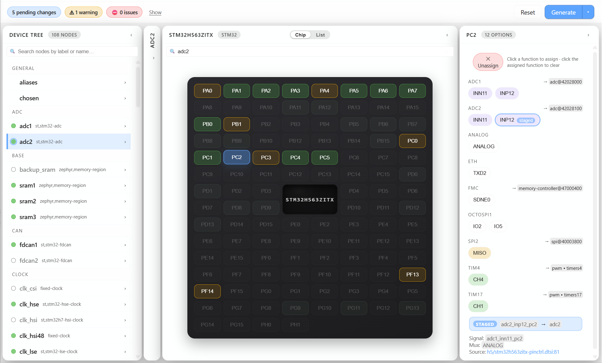

# Devicetree Manager for Zephyr

Devicetree editor and pin configurator for Zephyr RTOS projects. Companion
extension to [Workbench for Zephyr](https://github.com/Ac6Embedded/vscode-zephyr-workbench).

## What it does

A workbench panel that shows, for the currently selected Zephyr
application + build configuration, a unified view of every editable
surface of the devicetree:

- Pin muxing (chip pin matrix, vendor-themed)
- Devicetree node tree with binding-typed property editors
- Per-node detail card with tabs (Properties, Channels, Groups, Pin Groups, Regions, ...)
- Staging + overlay generation: writes `boards/<board>.overlay` with
  per-block, per-property merge so user edits survive regenerations.

Generalised so the same view works for any vendor whose HAL ships
machine-generated pinctrl descriptions (today: STM32, NXP MCX,
ESP32, Silicon Labs Series 2, Renesas RA and RA0, Infineon; tomorrow:
anyone we add a backend for).

Renesas does not ship its pin table with Zephyr. The first time you open
a Renesas RA board, the chip area offers an **Install** button: it
downloads the Renesas pin data (about 14 MB, from
[pinmapping-renesas](https://github.com/Ac6Embedded/pinmapping-renesas),
which republishes the pin files of each Renesas FSP release), checks it,
and keeps it in `~/.zephyr-workbench/devicetree-manager/renesas/`. Every
RA board then works offline. When a newer version is published, the
panel offers it (at most one check a week).

Infineon PSoC 6, PSoC 4, PSoC Control C3, CYW20829, XMC7000 / TRAVEO T2G,
PSoC Edge and XMC4500 / XMC4700 boards work out of the box: Zephyr
defines part of each chip's pin functions, and the rest come from the
Infineon HAL your build already uses. A function Zephyr has no pin node
for gets one in the overlay, written with Zephyr's own macros, and every
assigned pin gets the drive settings Infineon uses (an Infineon pin with
none does nothing).

## Requirements

- VS Code 1.88 or newer.
- A Python interpreter with `edtlib` (typically the Zephyr venv the
  Workbench is already configured against).

## Bundled (non-blocking)

- [Workbench for Zephyr](https://github.com/Ac6Embedded/vscode-zephyr-workbench)
  ships as an **extension pack** member, so installing this extension also
  installs the Workbench. It is a **soft dependency**, though: DT Manager
  does not require it to activate. When the Workbench is present, this
  extension talks to its API to discover Zephyr applications and build
  configurations and to reuse its configured Zephyr venv. If you disable or
  uninstall the Workbench, the panel still opens standalone on a build
  directory (see "How to open" below) and falls back to its own Python
  discovery.

## How to open

- From the Zephyr Workbench shortcut tree, click **Devicetree Manager**
  on an application or build configuration. The Workbench delegates to
  this extension via VSCode's command API and hands over the selected
  application + build config.
- From the command palette: `Devicetree Manager: Open`. Pick the app
  and build configuration inside the panel.

## Issues and feature requests

Bug reports and feature requests for this extension go on the
[Zephyr Workbench issue tracker](https://github.com/Ac6Embedded/vscode-zephyr-workbench/issues),
not on this repository. This repo only carries the public artefacts
(icon, README, CHANGELOG, LICENSE) the VS Code Marketplace links
against; the source code is maintained internally by Ac6.

## License

See [LICENSE](./LICENSE). Free to install and use; proprietary
(closed source).
